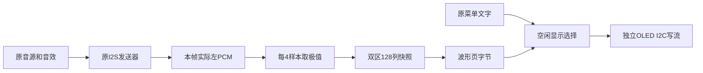
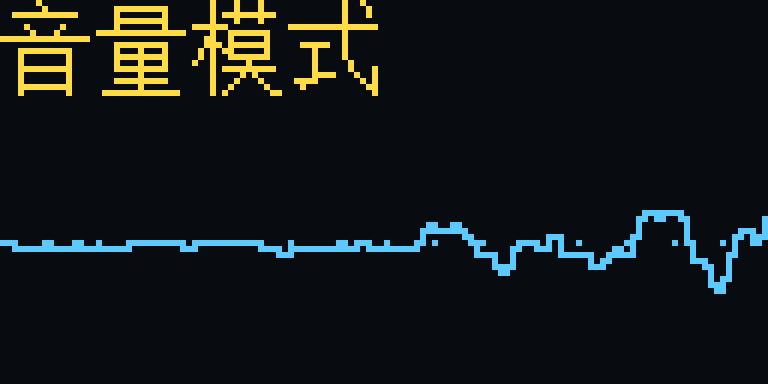

# OLED空闲实时波形与菜单状态保留

日期：2026-10-27。独立本地测试分支`codex/oled-idle-waveform`，以用户确认基本发声/握手恢复的R2源码为起点。原`ContestFull_HeadroomBootProbe_R2.fs`保持，未覆盖、未自动下载或推送；这项工作不修改音色，不实施物理建模，也没有改变按声部数调增益的既有策略。

## 用户操作与状态关系

- 滑条操作期间及松手后约3秒，OLED显示原音量/菜单界面。
- 滑条空闲约3秒，总菜单和任何子页面都只切换显示覆盖层：上方16像素保留当前页面标题，下方48像素显示实际音频波形。静音为水平线。
- 再次触摸滑条，恢复刚才的页面；这次手势继续交给原控制器，不要求额外触摸一下“唤醒”。原长按左端返回总菜单、长按右端回音量功能保留。
- 取消本板级配置原来总菜单闲置5秒自动回音量的动作；子页面也不因空闲跳转。显示进入波形**不意味着正在播放、录音、选定音色或页面状态被停止/重置**。
- 忙操作或错误有更高显示优先级；恢复正常且继续空闲后再次显示波形。旧菜单控制器默认超时规则仍可供其他入口使用，完整OLED波形顶层显式设`MENU_ROOT_IDLE_CYCLES=0`禁用自动归位。

波形来自当前实际发送的左声道PCM，并非根据按键编号播放预设动画。单声道显示避免左右相加时反相抵消；它用于演奏动态反馈，不是双声道测量示波器。力度、包络、音效和界面提示音若改变输出，都会影响图形。

## 目录、模块职责与接入

| 文件 | 职责 |
|---|---|
| `rtl/visual/oled_idle_view.v` | 空闲计时、触摸/状态变化唤醒及错误/忙优先，不改变菜单状态 |
| `rtl/visual/oled_wave_capture.v` | I2S实际PCM采样、每4样本取列极值、双区帧快照 |
| `rtl/visual/oled_wave_renderer.v` | 把128列上下边界转换成OLED页字节，添加零电平参考 |
| `rtl/visual/oled_i2c_stream.v` | OLED专用写流，控制字节＋1～128数据；ACK、延展、清总线及超时 |
| `rtl/visual/oled_status_display.v` | 组合原文字渲染与波形、锁存整帧状态、逐页批量发送与唤醒 |
| `rtl/board/board_contest_full_top.v` | 从LRCLK下降后的一拍读取本帧实际左PCM；开启波形并关闭菜单自动归位 |
| `rtl/instrument_full_system.v` | 新增仅供显示观察的`menu_touch_active`；不改公共V2接口 |
| `rtl/control/slider_menu_controller.v` | `ROOT_IDLE_CYCLES=0`明确表示禁用自动回音量，其余手势不改 |
| `rtl/performance/performance_controller.v` | 根据本轮真实STA，将25键音高/音色元数据写入拆为同拍逐键使能 |
| `scripts/analyze-oled-wave.py` | 从独立I2S解码PCM重算768个波形字节，与真实OLED捕获比较并渲染PNG |
| `scripts/verify-oled-idle-wave.ps1` | 冻结到英文目录、运行24项选定回归，可选隔离构建，无硬件操作 |
| `sim/tb_oled_wave_units.sv` | 采样极值、渲染、静音/显示饱和、帧一致性和菜单空闲状态保留 |
| `sim/tb_oled_wave_display.sv` | 外部I2C字节参考、整页传输、唤醒、NACK与复位 |
| `sim/tb_oled_wave_board.sv` | 完整顶层真实音源，独立解码I2S与OLED引脚，100kHz与音频隔离 |
| `sim/tb_oled_i2c_stream.sv` | 128字节、供数停顿、时钟延展、NACK、卡线超时与恢复 |
| `sim/tb_performance_held_write.sv`、`sim/performance_held_write_reference.v` | 冻结原曲谱控制器，逐拍比较元数据、状态和事务输出 |

不改接线、OLED七位地址0x3C、3.3V开漏、MPR121总线、UART/C3/客户端、PLL、CST或SDC。板载RGB仍保留R2启动诊断颜色，不恢复旧模式灯色；旧R2启动故障的根因仍未确认。

## 音频采样与双区存储



在LRCLK下降沿后的一拍，`debug_transmit_left`已更新为实际选中发送的PCM。观察逻辑仍使用原49.152MHz域，没有新时钟或跨域控制，启动/欠载发送的零也会采入。

每4个48kHz样本组成一列，128列共512样本，时间窗`512/48000=10.667ms`。每列保存上下各6位边界；把前一列交界样本纳入区间，以保持线条连续。两区总数据`256×12=3072bit`，前台用于稳定显示，后台捕获下一帧。后台完成后等待下个显示快照交换，前台整帧不变；采样观察器无ready，绝不反压音频。

显示中心为局部y=24；PCM算术右移15位后转换像素，超过±22像素的值只在**显示**中钳位。没有给实际音频乘这个显示增益，显示顶到底也不等于音频削波。该设置让当前较小PCM可见，同时不引入随音量自动拉满的显示增益；真实音符振幅不足一像素时可能看起来接近水平线。

RAM不逐字复位，由有效标志屏蔽旧数据；同步读取及渲染坐标各一拍对齐。最坏显示数据新鲜度受采集窗口与I2C帧周期限制，不能宣称OLED每48kHz样本都更新。

## I2C吞吐量、唤醒与故障隔离

保持原板级100kHz，使用一页128字节批量写，避免每个像素字节重复发送地址/控制。128x64屏幕有1024数据字节，仅数据位及ACK约92.16ms；加页命令和地址、控制、START/STOP及等待后，波形理论约每秒9～10帧，最终以实际总线与实屏为准。波形帧间额外等待5ms，普通菜单仍沿用40ms等待。

I2C事务中途不强行截断。波形显示期间触摸，在当前128字节页STOP后重新锁存菜单并从上方重绘。当前页最多约12ms完成，恢复整屏还需要约一帧时间；不是触摸后整屏零延迟。手势采集与音频继续运行，菜单输入不等待OLED。

NACK进入限速重试，SCL延展由同步输入确认，SDA卡低时先9脉冲清总线再尝试事务；看门狗超时释放线路。专用OLED流驱动没有改动给MPR121使用的`i2c_register_master`，仍维持原SDC中`oled_panel/display/bus/...sync_0_s0`的精确层级。缺屏不影响音频、按键或蓝牙握手。

## 实际开发验证与时序取舍

首轮6项专项仿真实际通过。其后17项初步集成回归实际通过，用于验证真实PCM到像素以及OLED故障隔离；最终源码另运行整合24项回归，不用初轮结果代替最终代码证明。

最终整合回归已实际完成：**24项正常用例全部通过**，84个生产HDL文件参与编译，原输入/冻结输入SHA在运行前后均一致。覆盖实际I2S至OLED像素、100kHz外部引脚时序、写流异常恢复、空闲菜单状态保持、原OLED菜单/音量、曲谱/学习/PANIC、64声部及I2S、原启动指示等。不是全部历史用例都运行；本轮未重新进行真实DAC或传感器采集延迟测量。

独立Python使用外部I2S解码的512个样本重算768个波形页字节，与实际OLED I2C捕获全部一致；本帧显示缩放饱和列数0。原文字部分另由菜单/音量回归覆盖，不将这768字节比较写成整屏1024字节的独立参考比较。证据见[最终回归摘要](reports/oled-idle-wave-20261027/modelsim-final/test-summary.json)及[独立像素分析](reports/oled-idle-wave-20261027/preview/analysis.json)。



第一份完整Gowin构建没有违反端点，但Setup/Hold只有0.003/0.024ns，未作为采用版。最差Setup由MPR121事件头选择，经源屏蔽/仲裁和曲谱事件ready，驱动曲谱按键元数据写入/复位端，14级组合、控制网扇出230。该长路径是重新布局后显露的既有路径，不在波形像素计算中；不能通过删约束来隐藏。

本轮将`held_note/held_timbre`由动态数组写改为25个明确的逐键写使能，保留原复位值、写入边沿与事件握手，无新增周期。冻结原`ad601f1`源码作独立参考，实际逐拍比较10348拍通过，覆盖随机控制、邻接提交/写、反压、重触发和复位；8项曲谱/学习等相关回归通过，并纳入最终24项。下表以重建后的实际Setup/Hold判断采用。

### 实际构建对照

| 构建 | Setup/ns | Hold/ns | Recovery/ns | Removal/ns | Logic | Register | BSRAM | DSP |
|---|---:|---:|---:|---:|---:|---:|---:|---:|
| 用户已确认基本功能R2 | 0.200 | 0.126 | 3.555 | 0.573 | 27891 | 19179 | 105 | 56.5 |
| 初轮OLED波形，未采用 | 0.003 | 0.024 | 4.384 | 0.530 | 27794 | 19204 | 106 | 56.5 |
| 分组写使能后，选用测试构建 | 0.381 | 0.163 | 4.242 | 0.389 | 27882 | 19141 | 106 | 56.5 |

第二轮实际综合、布局布线、静态时序和位流生成通过，报告违反端点0。整体比R2少9 Logic、38寄存器，新增1块BSRAM，DSP相同；综合总数变化含映射差异，不能理解为OLED本身不使用逻辑。剩余块RAM12/118，时序仍需要实板验证，不宣称后续随便加功能都安全。

实际位流SHA256：`987CCEEB8F0491E51254D89880EF2667B450AFF0B1C8B3125CEE16E3222F656C`。原输入、日志、报告在[构建证据](reports/oled-idle-wave-20261027/selected-r2/build-results.json)；15项ROM、时钟、CST/SDC与R2原版SHA核对一致。工具仍有既有告警，不能写成无告警构建；GAO只在冻结构建副本关闭，源GPRJ保留原配置。

本轮报告PRIMARY/LW仍8/8、PLLA仍3/8；没有增加PLL或新功能时钟。构建告警75条，新增OLED模块未出现单独的宽度等综合告警；既有普通布线时钟与跨时钟关系告警仍需结合原约束边界理解，不能只看余量数字认为整机已经实测合格。

当前没有对物理OLED、引脚上拉、线长、屏幕分区、R2改布局后的再次启动及长时间稳定性做实测。旧启动仿真中SIM跳过真实PLL动态初始化的边界仍存在。所有通过说明需区分数字仿真、STA和实板三类。

## 复现与板测顺序

```powershell
./scripts/verify-oled-idle-wave.ps1 `
  -Python 'C:/你的Python/python.exe' `
  -ModelSimBin 'C:/modelsim/modeltech64_10.6e/win64' `
  -StageParent 'C:/可写英文目录'
# 加-Build运行完整隔离构建；脚本不扫描/下载，也不覆盖旧full/impl。
```

后续板测先核对UserCode/FS哈希、启动绿灯、蓝牙握手和实体琴键，再观察OLED空闲3秒显示波形、按键时波动、静音水平线、触摸回原页面、总菜单/子页面都不自动跳回音量。最后检查拔掉OLED后音频是否继续。各项实物结果另记录，不把模拟图写成实屏照片。

### 本轮问题记录与保留范围

初轮0.003ns的构建记录保留，不用选用版报告覆盖。开发时曾在批量回归传入未登记的`router_performance_equivalence`用例名，运行器在编译前拒绝，因此那次没有执行测试；随后增加专门的`performance_held_write`用例及冻结参考，并实际通过后续8项和最终24项。运行器拒绝没有被写成测试通过。

新功能位于独立本地分支，原R2实板反馈对应FS保持哈希不变。新位流使用独立名字`ContestFull_OLEDIdleWave_TEST1024.fs`，Programmer日志UserCode应为`0x000010C2`，用于后续用户手动下载；无自动Program、无远端推送。暂未上板的项目一律标为待实测。
