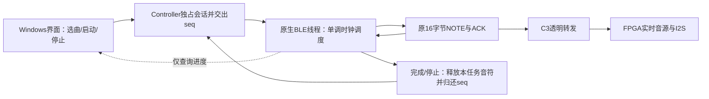

# Windows 1.5.1：最小化窗口后实时曲谱继续播放

日期：2026-10-27。开发分支：`codex/windows-minimized-playback`，基于OLED波形版`4bc95b1`。只修改Windows上位机，不修改FPGA RTL、引脚、PLL、C3、手机版或音量算法。

## 问题、原因和旧测试的边界

用户反馈Windows 1.5.0正常窗口可自动弹奏，最小化后显示滞后暴涨，随后停止。最后确认：只切换其他窗口没有复现，**最小化会复现**。

旧版曾取消`visibilitychange/blur`时的主动停播，但`RealtimeScore.Player`的计时、协议Session的ACK处理与超时均依赖WebView界面。旧界面测试只是用JavaScript修改`document.hidden`并分发事件，没有真正最小化Windows窗口。因此旧版“后台继续播放”只能说明取消了主动停止，不能证明最小化后稳定。

本轮建立真正的WebView2窗口，使用相同Controller/播放协调层与原生字节桥，仅把GATT另一端换成内存模拟FPGA。旧路径在真实最小化中实际复现：480条事件仅完成42条；首轮滞后426.6ms（最终复跑876.1ms），触发原250ms保护停止。不是根据用户现象猜测根因。

微软说明WebView2后台页面的定时任务存在节流，并提供开发诊断用的`disable-background-timer-throttling`标志；官方也不建议生产应用依赖此类标志。参考[微软WebView2标志说明](https://learn.microsoft.com/en-us/microsoft-edge/webview2/concepts/webview-features-flags)。本次采用原生后台调度，不修改系统电源策略、驱动、WebView全局设置或浏览器安全开关。

## 实现原则和模块



| 文件 | 责任 |
|---|---|
| `desktop/realtime_native/player.py` | 原生事件校验、绝对时间调度、休止/长按保活、本任务音符释放 |
| `desktop/realtime_native/protocol.py` | 原16字节CRC8帧、拆包/噪声恢复、单请求ACK、相同帧重试 |
| `desktop/native_host.py` | 将既有连接交给原生播放、分流ACK、停止/状态API、连接代际隔离 |
| `desktop/web/native-score-player.js` | 界面与原生任务适配；250ms进度查询不参与发音计时 |
| `desktop/web/controller.js` | 租用现有命令队列并冻结前端Session，完成后接回准确seq |
| `desktop/web/realtime-playback.js` | 保留启动准备，实际Windows连接选原生；网页/Demo保留旧JS路径 |
| `desktop/web/app.js`、`index.html` | 连接API接线与1.5.1版本号 |
| `desktop/build.ps1` | 纳入原生模块哈希；允许指定已安装依赖的虚拟环境 |
| `desktop/tests/test_native_playback.py` | 模拟GATT验证完整音符、保活、停止/ACK、超时、NACK、断连与代际 |
| `desktop/tests/test_native_lease.cjs` | 原生租用期间普通命令与心跳不交错、seq回绕/归还、停止后恢复查询 |
| `desktop/tests/probe_minimized_window.py` | 真实WebView2窗口最小化对照，不访问真实蓝牙 |
| `scripts/verify-windows-minimized.ps1` | 复现相关Python、JS、离线UI及可选真实最小化专项 |

### 协议、节拍和音符完整性

沿用来源63、MIDI音高0～127、力度0～127、音色0～3，原帧头/版本/CRC8/命令号不变。前端先完成原有释放、录制检查、板上曲谱停止及当前音色读取，随后才开始原生曲谱时钟。

原生事件循环使用单调时钟，所有事件共享起点；每次ACK耗时不累加为下一事件的间隔。保持原上限100000条事件、6小时、最多64个按住音符；结束必须有对应松键。不播放PCM，不写板上曲谱RAM；音色在启动时取板上当前选择，FPGA仍逐样本合成。

每次只发一个协议事务；ACK超时1.5秒，最多2次重试，重试保留完全相同的seq与帧。保留原250ms曲谱滞后保护，不通过增大阈值、跳过音符或降低曲速掩盖最小化问题。无线吞吐不足仍会明确停止；同刻和弦仍逐条发送，不能保证无线端完全同时到达。

休止或长按期间，原生线程每约1秒发送原`READBACK(0)`并消费其ACK，给板上远程音符看门狗保活。界面不刷新也不影响此行为。实际音符/参数仍只经过原有同一条连接，不建立第二个BLE客户端。

### 停止、断连及序号交接

播放任务占住Controller队列，JS心跳检测到`running`后让行。原生接管期间，ACK直接交给原生解析器，避免每音符向隐藏界面排回调。界面只读任务快照，即使进度文字暂停更新，声音也继续。此版前端普通通信操作会等待会话归还；若需要立即更改软件音效/参数，应先停止实时曲谱再操作。实体琴键与板上本地控制不经过这个前端队列。

停止通过独立API设置任务事件，唤醒长休止；若NOTE ON已发送，则等待当前事务确认后再发送本任务的NOTE OFF。不发送全局PANIC、不释放实体键。停止先于启动API到达时，按同一任务token取消；后续不同token不受影响。

完成或停止后，原生返回**下一可用seq**，前端按该值恢复同一会话，含255→0回绕。原生结果未知/ACK超时或连接丢失时关闭会话，停止保活，由板上既有看门狗兜底。旧连接的停止请求和通知不会影响新连接。关闭软件、结束进程、电脑睡眠/关机不承诺继续播放。

## 实际验证

| 项目 | 实际结果与边界 |
|---|---|
| 旧JS路径真实最小化 | 480条仅完成42条，最终复跑876.1ms滞后后中止；故障被复现 |
| 原生路径真实最小化 | 窗口最小化71秒；2800条全部发送，内容/顺序完全一致，最终复跑其中2759条在最小化期间发送 |
| 新路径滞后 | 首轮模拟最大发送至ACK滞后47.0ms、最终复跑46.0ms；不是射频或DAC延迟指标 |
| 恢复窗口 | 播放完成、FPGA模拟握手保持、后续状态查询成功，序号正确衔接 |
| 回归 | 最终52项Python、8组JS、3组离线UI通过；打包EXE自检通过，原生模块/界面资源哈希核对一致 |
| 真实蓝牙/DAC | **本次未测试，等待用户实际试听** |
| FPGA/OLED/5×5灯板 | 本次不重新构建或下载；OLED与灯板仍未实测 |

对照使用内存模拟器和真实Windows WebView2最小化，不把无头浏览器的`document.hidden`模拟当作真实最小化。测试窗口只最小化/还原自身，不扫描串口/BLE、不操作用户板卡。

开发中第一轮UI扩展回归因新工作区缺少MIDI夹具而拒绝运行直接曲谱页面；随后脚本明确先生成夹具再运行。另一个保活测试曾依赖Windows在80ms内唤醒3次而不稳定，改为收到第三次保活后主动停止，验证因果关系。最终通过的日志与开发失败分开，不把失败轮写成通过。

复现命令（Windows，需已安装`desktop/requirements.txt`）：

```powershell
./scripts/verify-windows-minimized.ps1 -Python 'C:/你的venv/Scripts/python.exe' -Node 'node' -IncludeUI -WindowProbe
./desktop/build.ps1 -VirtualEnvironment 'C:/你的venv' -SkipInstall `
  -OutputDirectory 'C:/输出/windows' -EvidenceDirectory 'C:/输出/build' -BuildDirectory 'C:/输出/work'
```

最终证据归档：`docs/reports/windows-minimized-20261027/`。新交付只需更换Windows软件，保留整个`_internal`目录；当前FPGA位流不需要因为这项修复重新烧录。用户复测时先保持窗口正常播放数秒，再最小化至少1分钟，恢复后检查进度和实际声音，测试停止/重播。该实物反馈另记，不能提前宣称通过。


最终长测退出时曾观察到WebView2对象已释放的回调日志；2800条事件、序号恢复和状态查询在退出前均已完成。专用测试窗口随后增加RPC返回后的250ms收尾等待，避免测试在报告返回前销毁控件；该调整不改变生产播放路径。
