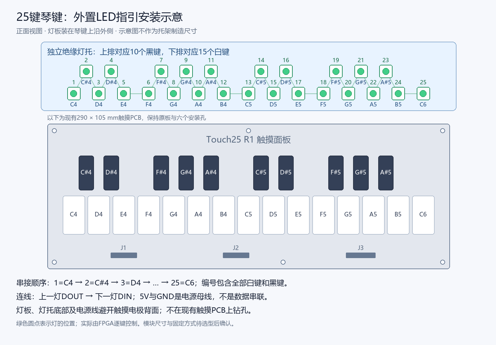

# 25键LED指引：选购与安装（2026-10-11）

本方案对应现有 Touch25 R1（290 × 105mm）与 `full/ContestFull.gprj`。琴键PCB是无源电极面板，不含LED、LED供电或LED安装孔。本说明只增加外置灯的选购与安装建议，不修改已打样Gerber或当前位流。实物灯仍未接入验收。

## 与赛题要求的关系

[高云2026竞赛官网选题二](https://www.gowinsemi.com.cn/university/match2026)列有FPGA硬件实时可视化和脱机演奏LED曲目指引。按25个键各配一颗可寻址LED，由FPGA直接生成灯数据，能用于逐键曲谱与节奏提示；脱机指引不依赖手机或蓝牙控制器。

当前RTL已经包含25灯、24位GRB输出，默认绿色、亮度32/255，脉宽及300µs锁存按WS2812B-V5/W规格核对。KEY1启动/停止静音曲谱指引；KEY0启动曲谱演奏并指引，KEY2复位。指引遮罩来自曲谱事件；普通手弹跟随、正确/错误双色反馈和提前亮灯未作为本次已完成能力。LED不能代替HDMI波形/频谱/XY显示，也不能作为第二个演奏输入维度或物理延迟证据。

## 推荐选型

优先选择 **5V WS2812B-V5/W单灯成品小板**：每板一灯、标清 `5V/GND/DIN/DOUT`、24位GRB、板宽建议约9～12mm，买30颗，用25颗、留5颗备用。可让商家按顺序预焊短线或提供明确输入/输出的插接线。公开商品名往往只写WS2812B，采购时需确认实际型号/数据手册，不能据此认定已完成实物兼容性验证。

国内搜索词：``WS2812B V5 单灯小板 5V DIN DOUT 预焊线。不要选RGBW、12V灯或自带音乐控制器的整套装；现有驱动为24位GRB，由FPGA控制。

尺寸明确的品牌备选是 [Adafruit NeoPixel Mini Button PCB，1612](https://www.adafruit.com/product/1612)：约9.1 × 9.1mm、5V、每包5颗，6包共30颗。官方注明可能使用WS2812B或SK6812，未锁定V5/W；该备选需按实际批次核对并先测试少量灯，不能直接标为现有位流已验收兼容。它是尺寸/级联方式的可靠参考，仍需焊线。

## 安装位置



将灯板固定在琴键上沿外侧的独立塑料/其他绝缘灯托：白键15颗一排、黑键10颗另一排，横向位置对准对应琴键。用原六孔固定面板和外壳/支撑结构，不在触摸PCB临时钻孔；托架与支柱尺寸按所购灯板、插头及焊点高度实测确定。图只表示位置关系，不是托架加工图。

25个半音在面板上的相邻横向间距有9mm和18mm，约10mm宽小灯板全放一排会局部重叠，普通60灯/米灯带也无法整条逐键对齐。两排灯仍按C4→C♯4→D4→…→C6顺序串接，不是先接完所有白键再接黑键。

灯板铜面、5V/GND母线、数据线和金属固定件均避开有效触摸区背面。最终装配后，要比较LED断电、通电熄灯、曲谱闪灯时的触摸噪声，并重新校准。LED线与MPR电极线、DAC时钟和喇叭线分开走。

## 供电与数据接线

```text
FPGA已核对的LED输出 → 74AHCT125输入
74AHCT125输出 → 330Ω → 第1灯DIN
第1灯DOUT → 第2灯DIN → … → 第25灯DIN

独立5V电源正极 → 全部灯板5V、74AHCT125 VCC
独立5V电源负极 → 全部灯板GND、74AHCT125 GND、FPGA GND
```

数据单向串接，电源为公共5V/GND母线。使用已组装、标清输入/输出/使能的74AHCT125模块，工作通道 `/OE` 需为低电平，不能悬空；如果裸芯片则须另加近端去耦并按数据手册接所有输入。器件的TTL兼容输入和4.5～5.5V供电范围见 [TI资料](https://www.ti.com/product/SN74AHCT125)。

推荐灯使用独立稳压5V 3A电源，已有多余合适电源可以复用。LED负载由该电源直接提供，电源母线建议短、足够粗（例如20～22AWG）；不要让整串灯的电流经细杜邦线、FPGA GPIO或MPR电极回路供电。不同电源的GND连接，正极不并接。

建议入口加1000µF/10V电解电容，正极接5V、负极接GND；330Ω放在首灯DIN附近。如果模块已含相应元件，按实际电路决定是否补充。电阻与电容是此次外挂装配建议，不是已打样琴键PCB的BOM。[NeoPixel安装建议](https://learn.adafruit.com/adafruit-neopixel-uberguide/best-practices)给出300～500Ω和500～1000µF范围。

当前约束输出球位是 **A15、3.3V**，依据31004 Rev1.4资料对应 **J13-14**。用户历史照片曾有31005字样，因此要先核对实际底板版本、pin1和导通，之后才能确定J13物理孔位；此处不能直接当作当前底板已确认的插孔。J1/J2/J3琴键接口和J4滑条接口都是触摸电极，不能接LED供电或数据。

## 首次验收

1. 全部断电，核对5V/GND极性、DIN/DOUT、转换模块使能；用万用表排查短路。先在桌面接少量灯确认信号方向，再接25灯。
2. 给灯电源上电，再启动FPGA；保持功放低音量，按KEY1。已有内置片段开头为E4，所以应先看到对应的第5灯，而不是默认第1灯。片段只使用部分琴键，不能以它证明25灯全部映射正确。
3. 接控制接口后，上传按键索引0～24逐个亮灭的事件曲谱，确认25灯对应C4～C6、没有跳灯/错灯/残留；这是后续测试步骤，本次尚未上传或实测。
4. 断开手机/蓝牙，KEY1启动与停止脱机指引；KEY0有声曲谱，KEY2复位。记录灯号、时刻与曲谱是否一致。
5. 灯工作时检查琴键误触、松手黏键和供电稳定，完成最终校准；整机延迟仍需仪器测量。

当前对应的软件证据见 `rtl/performance/ws2812_guide.v` 和 `rtl/performance/performance_controller.v`；板上按键验收见 [主工程板上复测](主工程板上复测-20261011.md)。KEY1声音控制已经由用户报告通过，外接LED尚未验收。
