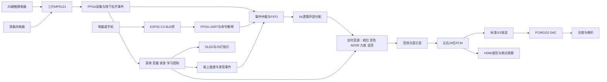

# 作品源码阅读入口与整机理解

整理日期：2026-10-26。先读本文，再按需要查逐文件清单，不必从几百个文件的第一行开始读。

## 1. 这次整理的是哪一份

本目录解释本地滑条音量测试版，冻结清点提交为 **`603a417df77731770730baeab8003b41f919b078`**。它归档的功能源码版本是 `7121713abc3d0c6a494d766cfe5601b852994fa9`。本次只整理文档和清点工具，在本地分支 `codex/source-guide-submission` 工作，不改音源、不下载板卡、不推送或合并main。

清点范围是该提交的 `TangMega60K_Synth/`，不包含电脑上其他工作区、Git内部数据库、未跟踪缓存和临时下载。

| 清点对象 | 数量 | 应如何理解 |
|---|---:|---|
| 冻结版本Git跟踪文件 | 1654 | 包括源码、ROM、工程配置、CAD、说明、报告和交付包 |
| 按本次口径识别的代码文件 | 520 | 包括HDL、客户端、固件、脚本、测试、第三方库与少量导出副本 |
| 配套/归档文件 | 1134 | 约束、数据、说明和报告等；其中151项带代码扩展名的历史快照/脚本/HTML报告也单独说明 |
| `rtl/`中的HDL文件 | 78 | 完整GPRJ均列入，但并非全部在完整顶层生效 |
| 完整顶层静态可达 | 59个模块、53个文件 | 含条件分支，不是综合后实际实例数，也不是振荡器数量 |
| 第三方BLE代码 | 60个文件 | 来源与修改范围必须单列，不能全计为自研代码 |

520个开发源码文件共73492行；此口径不混入docs、verification、releases的归档代码副本和生成HTML报告。这只是阅读范围统计，不是原创工作量、功能验收或评分依据。151项归档代码/报告没有省略，另在逐文件说明文末列出；字模、频率表、CAD与权限XML也有配套索引。

文档导航：

- [源码逐文件说明](源码逐文件说明.md)：520项开发源码与151项归档代码/报告用途；适合按文件名查找。
- [主工程模块连接索引](主工程模块连接索引.md)：当前顶层的直接子模块关系。
- [其他工程文件索引](其他工程文件索引.md)：1134项配套文件性质。
- [演示文档与视频编写方案](演示文档与视频编写方案.md)：报告主线、图表、演示顺序和素材准备。
- [提交源码范围与证据核对](提交源码范围与证据核对.md)：版本、已有证据、限制及提交包建议。
- [本次整理实现说明](本次整理实现说明.md)：清点方法、复现与核查结果。
- `源码清单.json`保存冻结提交的路径、SHA256、定义及静态关系；`文件用途.json`、`归档文件用途.json`保存人工用途说明。

## 2. 先把整机理解成一条传递链

可以把它想成一支乐队：琴键负责告诉乐队“弹什么”，声部分配器给每个音安排位置，音源算出声音，I2S把数字结果送给DAC，功放让喇叭有力气发声。屏幕和灯负责告诉人当前在做什么。

图中模块有的同时运行，有的在若干时钟里轮流完成工作。箭头表示传递的数据，不代表所有线都使用同一种协议。

## 3. 各文件夹相当于什么部门

| 位置 | 职责 | 你通常什么时候打开 |
|---|---|---|
| `full/` | 完整板级Gowin工程、引脚、时序、GAO配置 | 构建完整乐器、核对硬件连接 |
| `rtl/board/`、`rtl/instrument_full_system.v` | 板级接线与内部系统接线 | 队长查看整个系统如何组装 |
| `rtl/sensors/` | MPR121的I²C通信、触摸采集、键事件、滑条位置 | 实体按键/滑条不正常时 |
| `rtl/control/`、V2控制文件 | 菜单、命令、仲裁、表情与声部分配 | 按键与蓝牙冲突、模式或挂音问题 |
| `rtl/audio/`及`rom/` | 实时音源、音色参数、包络、混音、音效 | 讲解声音算法、分析听感与资源 |
| `rtl/performance/` | 曲谱事件、录制回放、等待弹对、灯驱动 | 演示脱机与辅助练习 |
| `rtl/remote/` | FPGA串口字节和通信帧 | 蓝牙能连但控制无响应时 |
| `rtl/visual/` | OLED、HDMI、波形/XY/频点显示 | 显示、帧刷新和跨时钟问题 |
| `rtl/clock/` | 音频PLL和厂商初始化IP | 时钟、锁定和复位问题 |
| `desktop/` | Windows上位机及测试 | 曲库、电脑琴键、上传、状态、学习界面 |
| `mobile/` | 手机网页业务、Android原生BLE宿主及测试 | 手机控制、MIDI导入和上传 |
| `firmware/ble_bridge/` | C3透明桥接固件 | BLE与FPGA UART之间的传递 |
| `firmware/libraries/BridgeBLE/` | 带本地修正的第三方BLE库 | 重建C3固件，需显式使用此库 |
| `hardware/` | 无源键盘、滑条、电平转换、灯板说明、背板CAD | PCB、布线、制造和装配 |
| `scripts/` | 构建、测试、离线生成参数、导出交付 | 复现验证与生成产物 |
| `sim/` | 测试台、参考实现和ModelSim波形入口 | 模拟外部设备、检查功能，不直接烧板 |
| `assets/`、`licenses/` | 钢琴拟合参数、素材与授权 | 说明音色来源和第三方依赖 |
| `docs/`、`verification/` | 接口、使用、技术解释与验证证据 | 写报告和核对“到底测过什么” |
| `releases/` | 按版本归档的交付包 | 找旧版本复现，不能混用位流 |
| `clock48/`、`boardkeys48/`、`board16/`、`boardseq16/` | 分功能的独立测试工程 | 先排除整机复杂度，分别测时钟、按键和声音 |
| `mono_diag/`、`mono_auto/`、根目录旧GPRJ | 早期或单音故障定位入口 | 排障/回归，不是当前提交的主入口 |

硬件文件夹里的触摸键盘与滑条是**无源电极板**。电容检测发生在MPR121；电极本身不是“每个键接一个电源输出”。PCM5102、功放与喇叭属于板外声音链，HDL不会直接把数字样本变成能推动喇叭的电流。

## 4. 以“按下一个C4”为例读主链路

### 第一步：知道手指按了哪里

`mpr121_sampler`通过`i2c_register_master`读取MPR121的数字寄存器。`mpr121_input_frontend`组织三组采集；25键按8/8/9分组，四电极滑条也由采集前端处理。

`mpr121_key_eventizer`比较前后完整触摸快照，把“原来没按、现在按了”变成NoteOn，把松开变成NoteOff。这里产生的是“按C4、力度100”的小命令，还没有音频波形。当前默认键力度不等于真实压力测量。

### 第二步：把命令稳妥交给空闲位置

`note_arbiter`在实体、远程、曲谱等事件之间选择；`event_fifo_v2`暂存来不及接收的事件。它们都要遵守`valid/ready`：只有同一上升沿两者均为1，事件才算被接走；接收方忙时，已拿出来的事件要保持不变。

`voice_allocator_v2`从64个逻辑位置中找空位，生成`cmd_*`给音源。例如“第7号声部，开始C4”。第7号只是内部位置，既不等于第7个琴键，也不等于右声道。一个键重弹、释放尾音和曲谱一起播放，都可能同时占用位置。

### 第三步：逐样本算出声音

`voice_engine`读取该声部的独立状态：现在相位多少、频率多少、包络到哪一步、选了哪种音色。基础DDS用频率控制字推动相位，波表返回当前幅度；八成分钢琴用两条`polar_lane`合成随时间变化的8个分量；可选FM走`fm_piano_lane`。

`adsr`决定起音和尾音，力度决定击键动态，`pitch_expression`处理平滑增益、弯音与颤音。`stereo_mixer`把本帧全部声部相加，`gain_saturator`进行缩放与饱和，得到左右两个24位数。

49.152MHz与48kHz的比值是1024：正常连续输出时，每个立体声采样帧有1024个音频时钟周期的计算预算。**64个逻辑声部主要通过独立状态和分时流水运算实现，并非复制64套完整大电路。**两条极坐标通道各处理4个分量，也不是把复音数降成2。

### 第四步：把两个数送到喇叭

`runtime_audio_fx`处理延迟/混响/合唱；`ui_tone_overlay`叠加短提示；`i2s_tx`把样本装入串行帧。48kHz表示每秒48000组左右样本；64声部已经混在这两个样本里。

每个声道32位槽，实际PCM为24位。FPGA输出BCLK、LRCLK与DATA，PCM5102解码为模拟左右声道，功放再驱动喇叭。I2S只是传递声音的格式，不能把PCM数字直接接到喇叭上。

### 第五步：松手不等于立刻删除声部

松键事件先让包络进入Release，尾音继续被计算。音源完成后发`done_*`，分配器才回收位置。若过早回收或反压时丢了松键，就会出现断音或挂音。这也是为何64声部验证必须包含停止后的完整释放。

## 5. 另三条链路也要讲得清

**滑条与菜单。**默认连续调音量；左端长按进入总菜单，四区选择音色/音区/录放/曲谱。子页面保留，左长按回总菜单，右长按回音量；只有总菜单满足空闲条件5秒后自动返回。`slider_volume_control`只提交gain掩码，`expression_controls_v2`在采样帧边界统一更新，已有平滑逻辑避免音量突变。OLED同时显示模式和四区选项。本版客户端尚未增加“音量页”状态编码，电脑/手机仍显示原菜单页，音量页以OLED为准。

**蓝牙。**Windows/手机把“弹哪个音/设什么参数”编码，C3透明转成UART，FPGA验帧后执行。C3不负责合成声音。对外串口帧的版本是V1，内部演奏`event/cmd/done/sample`协议称V2，两者不要混为一谈。电脑本地演示音也不是板上发声。

**曲谱、录音与学习。**上传的是带时间的按下/松开事件，存在板上RAM，断电不保存；1024条事件约可容纳512次完整按下/松开，具体还看曲谱内容。回放仍由同一HDL音源逐样本生成。直接MIDI音高模式可脱离25键，但不能逐键指引。学习模式使用25键目标，等待用户松手并按齐下一组；灯板须贴号并校准链序。Windows实时曲谱是持续传音符，需电脑连接，与“先上传再脱机播放”是两条不同路径。

## 6. 几种接口不要混淆

| 名称 | 传递的是什么 | 谁和谁之间 |
|---|---|---|
| I²C | 寄存器或显示命令/字节 | FPGA↔MPR121；另一路FPGA↔OLED |
| BLE/UART固定帧 | 音符、参数、曲谱与状态命令 | 上位机↔C3↔FPGA |
| `event_*` | 演奏事件，含来源/音高/力度/开关 | 输入、仲裁、队列、分配器 |
| `cmd_*` | 某声部开始、改音或释放 | 分配器→音源 |
| `done_*` | 某声部尾音真正结束 | 音源→分配器 |
| `engine_sample_begin`、`active_*` | 一帧共同使用的表情快照 | 表情控制↔音源 |
| `sample_*` | 左右PCM及握手 | 音源/音效→I2S |
| I2S | 已经混好的立体声数字样本 | FPGA→PCM5102 |
| WS2812 | 各灯颜色字节 | FPGA→电平转换→25灯板 |
| TMDS | 画面像素编码 | FPGA→HDMI显示器 |

## 7. 推荐分八次学，不要一次背完

1. 只读板级顶层的端口和`instrument_full_system`实例，找出输入与输出，在纸上画上面的整机图。
2. 只跟一个键的NoteOn/NoteOff：采集→事件→FIFO→分配器。先理解握手，不急着看乘法。
3. 看`voice_state_ram`和`dds_lane`：回答“为什么一个位置能记住自己弹到哪里”。再接波表与ADSR。
4. 看八成分钢琴和离线参数生成：区分样本参考、数学参数、实时计算；然后看FM为什么是另一条音色路径。
5. 看混音、定点位宽、增益和I2S：回答“64个音为什么最后只有左右两路”。
6. 看滑条菜单、录放与学习：把状态图和按键操作对应起来；用OLED四区文字解释给别人听。
7. 看上位机→C3→UART：每层只找输入、输出、队列和超时，理解“能蓝牙连接”不等于“FPGA已执行”。
8. 最后看测试、时序和资源报告：一个测试证明哪一段、起止边界是什么、哪些仍待实测。

每次学习都做同一件事：选一条真实操作，写出它经过哪些模块、每步数据是什么、忙时由谁等待。能把这件事讲顺，比先背全部文件名更有用。
