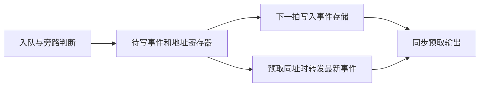

# 第二轮优化实现说明：用空余Register换取时序余量

## 先用通俗的话说明最终改了什么

事件队列保存的是“按下哪个音、力度多少、来自哪里”等命令，不是音频录音。
原设计把“能不能接收、是否走旁路、写哪个位置”等判断直接连到一大片存储单元。
这些判断和长接线挤在一个时钟周期里，只有0.168ns余量。

最终方案先把要写的命令、地址和有效标志放进一小组寄存器，再在下一拍写入存储。
如果下一拍恰好需要读取这个还在寄存器里的命令，就直接转发它，避免读到旧内容。
因此内部写存储推迟一拍，但音符对外入队、出队、反压和容量保持原样。
没有增加声部、改变音色或提高音频采样率；改善的是电路在49.152MHz下完成计算与传递的时间余量。



以后每轮优化都单独保留实现说明，至少包含目标、原理、修改文件和职责、前后数据、实际验证、问题处理及待实测项；不覆盖之前版本的说明。

## 目标与版本

用户明确目标是使用尚有余量的逻辑和寄存器改善性能，不追求最低资源数字。
基线是本地测试版f565de4，Setup/Hold最小余量0.168/0.166ns，Logic27208、Register18842、BSRAM105/118。
本轮仅在独立仓库的`codex/timing-resource-round2`分支实施。旧测试位流和稳定OLED版本保留，main不修改、不推送、不下载板卡。

## 第一项：事件队列写通路寄存

上一版实际STA关键路径为板载复位状态经过事件仲裁、旁路判断、FIFO写地址译码到事件存储阵列CE；延迟19.866ns，余量仅0.168ns。
在`rtl/event_fifo_v2.v`增加待写事件、地址和有效位，物理RAM写延后一拍。
外部入队/出队、容量、顺序和反压保持原拍次；若预取恰好读取尚未物理写入的地址，从待写寄存器转发完整事件。
异步复位清除待写有效位，不清RAM。只要valid未置起，旧内容不会成为新事件。

`sim/event_fifo_v2_pipeline_reference.v`冻结基线FIFO，文件头记录SHA256。
`sim/tb_event_fifo_pipeline.sv`逐拍比较新旧FIFO并使用独立期望队列，覆盖2/4/8/64深度、源编号位宽、满载反压、连续读写、绕回和异步复位。

完整主工程的缓存负载为23位、地址6位、有效位1位，源码增加30位寄存状态；综合重映射后的全工程Register净增加29个。
复位只取消有效位，不要求把所有RAM内容清零；没有有效事件时旧内容不能被消费。

## 最终选用版的前后对比

| 项目 | 上一TimingTouch测试版 | 本轮选用版 | 变化 |
|---|---:|---:|---:|
| Setup最小余量/ns | 0.168 | 0.457 | +0.289 |
| Hold最小余量/ns | 0.166 | 0.126 | -0.040，仍通过 |
| Recovery最小余量/ns | 1.961 | 3.851 | +1.890 |
| Removal最小余量/ns | 0.474 | 0.484 | +0.010 |
| Logic | 27208 | 27021 | -187 |
| Register | 18842 | 18871 | +29 |
| BSRAM | 105/118 | 105/118 | 不变 |
| DSP | 51.5/118 | 51.5/118 | 不变 |

余量来自实际Gowin布局布线报告，Setup/Hold违反端点均为0。
这是用额外寄存器换取Setup改善的选型，不把Hold减小隐去，也不声称所有时序都变好。
Setup仍不到1ns，后续修改仍需要重新验证；没有将49.152MHz改成更低频率来换通过。
Logic减少来自综合重映射，目标不是把Logic/Register占满；真正占用多少应以实现后的报告为准。

## 未选用实验二：曲谱上传分组完成标志

`rtl/performance/score_upload_tracker.v`独立负责上传位图和完整性查询。
每16行额外保存一个同步完成标志，1024行增加64个标志寄存器。
完整组直接使用寄存结果，最多一个部分组按原位图检查；命令参数不再逐行穿过1024个完整范围比较再做全量归约。
完成标志与最后一行写入同沿更新，因此不额外推迟提交或提前ACK。
清批次与新写入同拍时，先清旧位图再保留新写入行，分组标志同样按清后状态计算；支持乱序、重复覆盖和非16整数倍容量。
`performance_controller.v`只接入该模块，原有曲谱RAM、提交状态码、事件时序和容量不变。
新模块仅加入本分支的工程文件，不改变顶层引脚或V2端口。
`sim/tb_score_upload_tracker.sv`用旧逐行公式逐拍比对，包含1/4/17/32/1024行配置、16位count查询、重复与乱序写、复位和同拍清写。

## 验证与交付状态

实际完成的选型结果如下；最终选用代码已完成27项ModelSim检查并与实际布局布线输入逐项核对。
新的候选位流必须功能回归和实际Gowin布局布线时序均通过，不能把生成.fs当成通过。
板级稳定性、实体触摸到DAC/喇叭总延迟及64音实测频谱仍待实测。

| 实际候选 | Setup/ns | Hold/ns | Register | 结论 |
|---|---:|---:|---:|---|
| 上一TimingTouch测试版 | 0.168 | 0.166 | 18842 | 基线 |
| 只增加FIFO写缓存 | 0.457 | 0.126 | 18871 | 选用，Setup收益最大且功能拍次一致 |
| 再增加曲谱分组完成标志 | 0.177 | 0.189 | 18935 | 保存实验，不纳入最终交付 |
| 再增加仲裁输出事件缓存 | 0.001 | 0.010 | 18961 | 虽通过STA，但余量过小，不选用 |

增加寄存器并不保证全工程最差路径改善，新的ready回路及布局也会改变瓶颈。
因此本轮最终选择第一候选；第二、三候选的源码在`codex/timing-resource-round2-experiments`分支保留，最终交付分支只采用FIFO写缓存，不包含这些未选用模块。

## 未选用实验三：仲裁后的完整事件弹性寄存器

第一候选（FIFO写寄存器）实际Setup/Hold为0.457/0.126ns，Register增加29个。
第二候选再加曲谱完成标志后，实际为0.177/0.189ns，Register共增加93个；所有检查通过，但Setup收益很小，未据此结束优化。
实际关键路径变成传感器事件经过仲裁/接收控制到远程看门狗held位，14级逻辑。

新增`rtl/control/note_event_pipeline.v`，在来源仲裁后把23位事件和2位来源通道编号一起缓存。
`instrument_full_system.v`将仲裁输出接到该弹性缓存，再送原FIFO；录音仍使用实际入队事件对应的来源编号，不会把曲谱自身误录进去。
新增一拍约20.35ns（49.152MHz），持续流吞吐量仍可每拍一条；反压时完整事件和来源标签一起保持。
缓存与音源共用audio_rst_n，PANIC/复位清空缓存，不让旧事件在停止后重新进入队列。
原note_arbiter算法、四路来源和V2接口不变。

`sim/tb_note_event_pipeline.sv`使用独立期望队列验证连续每拍吞吐、来源/负载一致、随机反压及异步复位。
实验三的回归增加`remote_note_watchdog`和`watchdog_arbiter`，共29项（包括两项既有注错拒绝）；修正夹具后已实际全部通过，但仍因时序余量过小而不选用。

首次第三候选针对性回归9/10通过，`global_panic`失败于测试夹具原先假定25条事件都留在传感器队列；实际为队列24条和新增缓存1条。
因此更新`tb_global_panic.sv`的占用及丢弃计数：队列加缓存必须精确等于25，缓存必须包含且丢弃1条，复位必须清空缓存有效位，停止后旧事件不得重新发声。
没有把25改成24，也没有降低停止门限；其余ACK、隔离、后续新触摸和看门狗释放检查保留。

## 运行与目录

- `rtl/event_fifo_v2.v`：FIFO数据和同址转发；外部出入队拍次不因物理写推迟而改变。
- `sim/`：冻结参考、独立期望队列和边界验证；不加入综合。
- `scripts/verify-pipeline-round2.ps1`：冻结英文隔离副本，运行最终27项ModelSim及可选Gowin构建。
- `scripts/package-pipeline-round2.py`：核对生产源码/ROM/约束哈希、实际STA与27项回归，整理交付。
- `delivery-pipeline-round2/`：仅在最终验收后生成。最终位流与旧版本使用不同文件名。

最终版唯一生产RTL修改是`rtl/event_fifo_v2.v`；原工程文件、顶层连接和其他模块保持上一测试版。

实验二/三的新增RTL、测试和顶层连接仅保留在`codex/timing-resource-round2-experiments`分支，最终测试版不包含。
最终只增加FIFO等价检查与两项看门狗相关回归，在原24项基础上共27项；不用实验三的29项结果冒充最终代码验证。

```powershell
.\scripts\verify-pipeline-round2.ps1 -Python 'C:/你的Python/python.exe' `
    -ModelSimBin 'C:/modelsim/modeltech64_10.6e/win64' `
    -StageParent 'C:/可写的英文目录' -Build
```

Python需要3.11+；Gowin默认1.9.12。脚本不访问USB、串口或BLE。
本机受限环境的默认临时目录首次创建失败，随后通过显式StageParent修正；受限环境无法启动ModelSim原生工具时，仅授权在沙箱外运行本地EDA验证，未触碰板卡。
Windows既有CRLF文件按CRLF检查，不为了格式改动已验证RTL的字节。

## 最终实际验证与剩余问题

2026-10-26，最终只采用FIFO写缓存的版本完成27项ModelSim检查，25项正常检查和2项既有注错拒绝检查均通过。
覆盖FIFO逐拍等价、音源三种种子等价、原始错误注入拒绝、真实串行触摸到I2S、OLED、四区菜单、录放、1024行曲谱、直接音高、等候学习、PANIC、远程看门狗、反压及连续音频供数。
新FIFO四个配置共64714个检查时钟，3852次同址转发，输出与冻结参考逐拍一致，并用独立期望队列核对顺序。
测试中的异步复位会主动丢弃旧队列，因此全程累计push/pop不必相等；每个复位周期后的有效事件仍由独立队列模型核对，最终一轮已排空。

最终生产输入91项与第一候选实际构建完全一致。原OLED位流和上一TimingTouch位流SHA256核对未变。
PLL、CST/SDC、ROM、49.152MHz/48kHz/24位Philips I2S、64声部、音色及音量标度均保持。
数字触摸状态变化到首完整非零I2S字仍为1.302～2.867ms，四场景差异1.565ms；25键全部命令约3.047ms。不能据此宣称真实手指到声音≤5ms/≤10ms或无抖动。
本轮未重新运行64音FFT，也没有测DAC或喇叭，未验证此前偶发硬件掉电/断声问题已消失。

- Setup最差路径现位于传感器事件到录放控制，而不是原先的FIFO存储写使能；后续应从控制依赖和局部握手着手，不盲目增加寄存层。
- PRIMARY8/8、LW8/8、PLLA3/8；本轮未新增时钟。逻辑/寄存器有空余，不等于时钟和块RAM有同样余量。
- Gowin既有PR1014等警告保留，完整原始日志随包提供；未加入假路径/多周期例外或降低约束来掩盖问题。
- ModelSim是RTL及既有厂商原语模型仿真，不是本轮新增的门级网表仿真；下载后长期稳定性仍待实测。
- 主工程和公共V2接口未改，未修改Windows/C3/手机端；不直接推送或合并main。

最终位流：`ContestFull_PipelineRound2_TEST1024.fs`。
SHA256：`E08012C3DF7C3C7802C6F75B6549FD3CD3E7C050CD738A0622B735CF2994A573`。

持久报告在`docs/reports/pipeline-round2-20261026/`，交付原始日志在`delivery-pipeline-round2/evidence/`。
第一候选实际构建目录：`TangDirectScore_234n0d0c/verification/build-round2/build_fifo-write-pipeline-r1_20261026_195601_4f803ab2`。
最终27项回归目录：`TangDirectScore_vime8u38/verification/modelsim-pipeline-round2/run_20261026_201446_395fb472`。
这些现场位于本机英文隔离目录，长期复查以本仓库保存的报告和交付清单为准。
