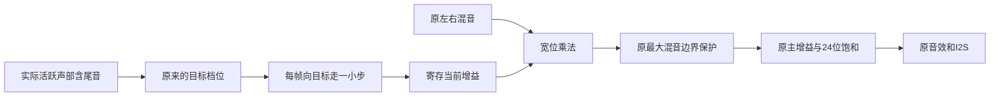

# 混音增益跨档平滑：本地测试版

日期：2026-10-27。分支`codex/headroom-smoothing`，以`20aa6f9`为基线；其生产RTL与滑条音量版`603a417/7121713`一致。黑匣子/模式同步试验已取消采用，仅在`codex/diagnostics-mode-sync`本地分支归档，不包含在本轮音频版本。未推送/合并main，不自动下载板卡。

## 1. 问题与目标

现有自动混音余量按实际活跃声部（含Release尾音）选择倍数：

| 活跃数 | 原增益倍数 |
|---|---:|
| 1 | 64 |
| 2 | 32 |
| 3～4 | 16 |
| 5～8 | 8 |
| 9～16 | 4 |
| 17～32 | 2 |
| 33～64 | 1 |

它让少量声部使用预留给64声部的余量，避免单音过轻，但跨边界会在相邻采样帧直接切换总增益。例如C4正在持续发声，新按下E4时，即使E4的包络从零缓慢起音，原C4也会立刻被整体减半；E4尾音回收时C4可能突然翻倍。单个声部ADSR无法单独消除这个全局变化。

本轮只处理这个明确的数字通路变化：保持各档**稳态倍数、原音色、表情增益、24位输出和声部调度**，把跨档改成短斜坡。不能把它直接认定为用户现场噼啪声的唯一原因；接触、供电、DAC/功放仍可能导致独立问题。

小白可以这样理解：原来加入第二个音，好比把总音量旋钮一下转到一半；现在把这次转动分成最多64个小步。最后停在同一个位置，单音和和弦的稳定音量不变。第一声没有额外等64帧才开始，斜坡只是对已经在播放的混音逐样本调整。



## 2. 文件与职责

| 文件 | 职责 |
|---|---|
| `rtl/audio/headroom_smoother.v` | 帧级增益斜坡、宽乘积、瞬态峰值保护，不负责DDS/音色或命令 |
| `rtl/audio/voice_engine.v` | 新增参数`HEADROOM_SMOOTH=0`，按现有帧调度连接可选平滑器；其他入口默认保留旧行为 |
| `rtl/instrument_full_system.v` | 完整乐器显式启用平滑，原接口、时钟、音效和本地菜单保持 |
| `full/ContestFull.gprj` | 增加一个HDL输入；引脚/时序约束不变 |
| `sim/tb_headroom_smoother.sv` | 独立64位整数参考检查1～64档、相干最大混音、重定目标、停顿与复位 |
| `sim/tb_headroom_smoothing.sv` | 两份实际音源收到同一命令，N=4导出对比，N=64验证供数/完整释放/最大表情 |
| `scripts/analyze-headroom-smoothing.py` | 逐样本核对原始混音和输出，隔离增益变化贡献，导出未归一化24位WAV |
| `scripts/test-headroom-analysis.py` | 人工夹具检查分析器能拒绝错误PCM/编号，不作为RTL通过证据 |
| `scripts/verify-headroom-smoothing.ps1` | 原38项＋4项新增/兼容回归，共42项，支持隔离构建 |
| `scripts/package-headroom-smoothing.py` | 先核对实际构建/回归/当前输入SHA，再整理位流、GUI源码、PCM和证据，不操作板卡 |

音源公共`cmd/done/sample` V2端口不变。Windows、手机、C3、OLED协议和所有传感器代码没有随本轮更改，不需要更换客户端。原诊断自检入口默认仍`HEADROOM_SMOOTH=0`，避免改变既有频谱验收基线。

## 3. 算法、定点与调度

增益使用17位无符号Q10：1024表示1倍、65536表示64倍；参与有符号乘法前补一个0，避免64倍被解释成负数。混音32位乘增益18位，保留50位有符号乘积，加512后算术右移10位。

新目标出现时，计算`step=ceil(abs(target-current)/64)`，随后每生成一帧向目标走一步，到达后精确钳到目标。目标未变化时不重新计算步长；斜坡未结束又换目标，从当前实际增益继续。目标保持不变、连续48kHz时，最多64帧即1.333ms；单位是生成帧数，受反压停顿时不会偷偷推进。

真正无声部时清除斜坡初始化标志；下一次首音直接使用原64倍，避免改变首音响度。释放尾音仍计入活跃数，不按按住键数提前放大。某声部结束后，其他声部用短斜坡过渡到原来的目标档。

最后一个声部的`V_MIX`边沿寄存下一增益，同时混音器累加最后声部；随后`V_WRITE`边沿使用更新后的混音和已寄存增益计算乘积，原`MASTER`边沿继续由`gain_saturator`处理。利用原状态间隔拆分“档位/斜坡→乘法”的长组合路径，不增加调度状态，不改变cmd/样本/done握手拍次。输出反压时结果保持不变，恢复后继续正常下一帧。独立使用平滑模块时，混音输入须在start后一拍乘积采集前保持稳定。

### 为什么要瞬态峰值保护

原式满足`声部数×倍数≤64`。平滑下降时新声部已经加入，当前增益却暂时高于新目标，因此不能沿用原边界推导而不处理过渡峰值。

本实现将放大后混音限制在原64路16位相干求和边界`[-2097152,2097088]`，再交给原Q1.11主增益/24位饱和。默认MASTER_SHIFT=1时，连同最大4095/2048表情增益也在原安全范围内。乘法中间值始终宽位保留，不能先截断再检查。

**这是一项瞬态限幅，发生时会产生非线性，不能声称所有极端情况完全无失真。**独立最坏相干值测试实际覆盖保护动作；本次N=4/N=64钢琴激励均未触发它。若以后改变MASTER_SHIFT、混音输入位宽或最大增益，必须重新推导边界，不能直接复用常数。

稳态各档都是整数倍，移位与Q10乘法结果完全一致，随后仍经过原一次主增益舍入。本轮对到达稳态且未触发保护的输出逐位比较，不以“差不多一样大”代替标度验证。

## 4. 实际专项结果

本轮已执行ModelSim独立专项4项：

| 用例 | 实际结果 |
|---|---|
| `headroom_smoother` | 8283次数学校验，184次峰值保护覆盖；各档稳态、连续重定目标、无start保持与复位通过 |
| `headroom_smoothing_n4` | 16008组PCM；15373702拍反压稳定检查；同键重触发、双音加入/释放，削波0 |
| `headroom_smoothing_n64` | 5531组PCM；296380拍反压检查；64尾音done全部回收、最大表情增益，削波0 |
| `headroom_legacy` | 默认不开平滑的旧64声部余量比例、释放、25个音高及静音回归通过 |

最终整理后的源码已重新实际运行**42项选定ModelSim回归，全部满足预期**：40项正常通过，2项故意注入错误被正确拒绝。覆盖原滑条音量、OLED、菜单、学习/曲谱、MPR121、事件队列、声部与I2S集成及上述4项新增/兼容用例。79个生产HDL文件参与编译，仿真输入运行前后SHA一致；不是全部历史测试台和所有长试听都跑过。原始摘要与逐项日志见[ModelSim记录](reports/headroom-smoothing-20261027/modelsim-final/test-summary.json)。

独立Python分析核对上述N=4/N=64每个样本均与原始混音/增益公式一致。N=4有15882组稳态逐位一致，N=64有5405组；实际钢琴采集保护动作0、24位端点削波0。相同稳态幅度并非对整段WAV另行归一化得到。

N=4两个可听范围内跨档的隔离贡献：

| 声部变化 | 原瞬间增益变化贡献/PCM单位 | 新瞬间贡献 | 减少 | 目标到达 |
|---|---:|---:|---:|---:|
| 1→2 | 94144 | 1472 | 98.436% | 64帧 |
| 2→1（尾音回收） | 42304 | 662 | 98.435% | 64帧 |

此计算使用同一当前原始混音，分别比较前后增益的作用，避免把自然波形斜率直接称为噪声。整个片段最大相邻样本差从54336到46080，并不等于噪声下降98%；98.4%只针对表中两个跨档瞬间的增益贡献。真正听感与现场噼啪仍需实测。

提供`original-hdl.wav`与`smoothed-hdl.wav`，相同命令/音色/力度/音高/48kHz/24位，无独立归一化；`original-then-smoothed.wav`先旧后新，中间250ms静音。N=4片段约0.334秒，是有针对性的短音/尾音比较，不是完整演奏。PCM来自HDL，不是Python另写合成器。

## 5. 复现与接入

```powershell
./scripts/verify-headroom-smoothing.ps1 -Python 'C:/你的Python/python.exe' `
    -ModelSimBin 'C:/modelsim/modeltech64_10.6e/win64' -StageParent 'C:/可写英文目录'
# 加-Build运行隔离Gowin布局布线；不自动下载，不覆盖旧full/impl。
python scripts/test-headroom-analysis.py
```

独立接入只需在既有`voice_engine`参数显式设`.AUTO_HEADROOM(1), .HEADROOM_SMOOTH(1)`，并将`headroom_smoother.v`列入工程；不新增引脚或公共音源端口。`HEADROOM_SMOOTH=0`或`AUTO_HEADROOM=0`走旧支路，后者不综合平滑乘法器。

## 6. 布局布线取舍与保护范围

所有候选使用原CST/SDC、50MHz板上参考与49.152MHz音频时钟，完整顶层48kHz、24位标准Philips I2S、每声道32位槽。隔离构建关闭GAO，与原滑条音量版的比较条件一致；没有通过降低音频采样率、减少声部或放松约束取得时序通过。

| 实际构建 | Setup余量/ns | Hold余量/ns | Logic | Register | BSRAM | DSP |
|---|---:|---:|---:|---:|---:|---:|
| 原滑条音量基线 | 0.618 | 0.093 | 27705 | 19036 | 105 | 52.5 |
| 第一候选：同拍增益和乘法 | 0.122 | 0.126 | 27873 | 19155 | 105 | 56.5 |
| 第二候选：利用原状态拆开流水 | 0.338 | 0.101 | 27679 | 19157 | 105 | 56.5 |
| 最终整理版：重新实际构建 | 0.338 | 0.101 | 27679 | 19157 | 105 | 56.5 |

第一候选的最差Setup路径落在声部计数到新增乘积寄存器，说明新增逻辑确实压缩了余量。第二候选先寄存增益、下一拍乘法，最差Setup路径已转回原有`pressed_sync_2→performance/held_note/.../RESET`，本次没有继续扩大修改范围处理该旧路径。

第二候选相对原基线新增121个寄存器、4个报告DSP单位，BSRAM不变；Logic综合总数少26只是优化映射结果，不能据此说新增模块“完全不占Logic”。Setup仍比原基线少0.280ns，余量偏紧，需要作为测试版本上板比较；时序通过不等于所有硬件问题已经解决。

最终整理版已重新实际完成综合、布局布线、静态时序与位流生成。Recovery/Removal最小余量4.479/0.566ns，工具报告Setup/Hold违反端点均为0；PRIMARY与LW仍分别8/8，PLLA仍3/8。综合79条既有告警、未出现新的平滑器告警，不能称为“无任何警告”。94个构建输入与当前源码SHA核对一致，ROM、时钟及引脚/时序约束15项与原基线逐文件一致。

记录在[`reports/headroom-smoothing-20261027/selected/`](reports/headroom-smoothing-20261027/selected/build-results.json)。位流SHA256为`2415136A6A5DC6278B8772AE6E2F3C83290882282383437C5CA35A7D15F3ECA9`。候选历史仅用于说明优化过程，不代替最终源码的验证。

最终源码的触摸/I2S数字专项4个场景通过，起点为仿真MPR121已滤波状态寄存器变化，终点为I2S引脚解码到完整非零24位样本，观测1.301951～2.867067ms，与原基线范围相同。有限场景不代表严格最坏上界、无抖动或真实手指到声音的实测。**64帧斜坡是已经播放时的音量过渡，不给新音增加1.333ms等待。**详细分段见[数字延迟分析](reports/headroom-smoothing-20261027/latency/延迟分段结果.md)。

## 7. 交付与尚未验证项目

交付包含独立模块、现有音源中的可选接入、测试台、复现脚本、未归一化HDL WAV、原始PCM、ModelSim日志与Gowin时序资源报告。原完整工程实现目录和旧位流保留；本轮无引脚迁移、无客户端更新、无黑匣子功能、无自动扫描/下载、无远端推送。

打包时另外处理了Gowin输出文件可能带只读属性的问题：内容相同的副本按SHA跳过，需要更新时仅修改生成交付目录中副本的属性，不更改构建快照。源码目录保留技术说明与原相对报告结构，根目录说明重写报告链接；解压后的本地链接也做检查。这些是交付脚本修改，不改变已验证音频RTL。

尚未上板，不宣称解决模拟硬件噪声、整机≤5ms/≤10ms或完成DAC频谱验证。两个测试片段未削波不代表所有曲目/最大相干输入都无瞬态限幅；保护动作与非线性必须结合实际演奏继续评估。

### 后续怎样与原版对比

1. 保留原`ContestFull_SliderVolume_TEST1024.fs`，新文件单独命名`ContestFull_HeadroomSmooth_TEST1024.fs`；不要覆盖旧文件或把两份混在同一个下载记录中。
2. 两次使用相同音色、滑条音量、DAC/功放旋钮与接线。持续按住一个音，再加入第二个音，松开第二音并等尾音结束；重点听加入及回收时原持续音的音量变化。
3. 再试同键快速重触发与多键轮换，记录噼啪是否减少、音量是否有不自然起伏。若单音持续播放也出现噼啪，应另查供电/连线/模拟通路，不能用本次跨档分析替代故障定位。
4. 仿真对比文件`analysis-n4/original-then-smoothed.wav`先旧后新、无分别归一化，只有约0.334秒的短片段各一段；适合观察本次测试动作，不能代表整首乐曲的听感。

是否正式采用需要实板比较，本轮只交付独立本地测试版本。
