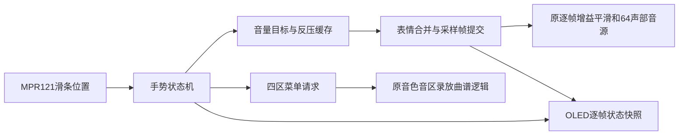

# 滑条音量演奏模式实现说明

## 目标和交互约定

以本地已验证FIFO写缓存版548ae25为基线，在`codex/slider-volume-performance`独立测试分支实施。
旧版保留，不修改main、不推送、不自动下载板卡。

- 上电默认音量演奏模式；在滑条上移动手指，连续控制0～100%音量。
- 新触摸最左端并长按约1秒进入总菜单；长按期间不先把音量拉到零。
- 总菜单保持原四项：音色、音区、录放、曲谱。只有总菜单在5秒无触摸且没有未完成请求/菜单忙操作时自动回音量。
- 进入子页面后不自动返回；长按左端回总菜单，长按右端直接回音量模式。
- 手动返回的当次触摸必须松开，下一次触摸才允许调音量。
- 页面返回不执行停止/清空，不改变已开始的录制、播放、指引或学习任务。
- 滑条与蓝牙音量最后一次有效提交生效；滑条只提交gain掩码，不能覆盖弯音和颤音。
- 音量沿用现有V2参数提交、采样帧快照和逐样本增益平滑；不修改八成分钢琴或音量基准。

## 实施范围

手势控制、音量目标/反压处理、OLED显示分别组织为模块；主顶层负责连线。
公共event/cmd/done/sample V2接口、引脚、PLL、48kHz/24位Philips I2S保持。
实现结束后补入实际修改文件、验证命令、时序/资源前后对比和待实测事项，不以生成.fs作为通过。

## 模块与实现原理

| 文件 | 职责 |
|---|---|
| `rtl/control/slider_menu_controller.v` | 音量、总菜单、四个子页面的手势状态；根菜单超时；左/右长按；松手隔离与故障取消。旧调用默认关闭新模式以保留既有行为 |
| `rtl/control/slider_volume_control.v` | 位置0..3072映射为Q1.11增益0..2048，反压时保持已呈现事务，未呈现的位置合并为最新值；新触摸可重新取得音量控制权 |
| `rtl/control/gain_percent_meter.v` | 观察已经按采样边界提交的gain，转换百分比；不反馈到音频ready或增益运算 |
| `rtl/instrument_full_system.v` | 连接本地音量与原表情合并器，掩码固定001，只允许修改gain；原弯音/颤音独立保留 |
| `rtl/board/board_contest_full_top.v` | 完整主工程默认启用新模式，接通OLED观察信号；不改变硬件引脚 |
| `rtl/visual/oled_status_display.v` | 每帧锁存模式、音量和录放状态，两路十进制转换分别记住完成状态，掉屏不阻塞音频 |
| `rtl/visual/oled_menu_renderer.v` | 音量百分比/刻度条、菜单标题、区1..4、四组选项及高亮 |
| `scripts/generate-menu-font.py` | 从同版本Unifont可复现生成ROM与显示模块；复用原OFL授权需核对源字体SHA256 |

实际增益沿用`expression_merge → expression_controls_v2 → pitch_expression → voice_engine`。
每生成一帧只提交一份全局参数快照，音量每帧最多变化8个Q1.11单位，满量程到静音约256帧，即48kHz下约5.33ms。
这段是主动音量平滑，并不是每次弹琴额外增加5.33ms延迟。声部频率、包络和混音音量基准保持原样。
映射采用683/1024近似2/3，最大误差1个Q1.11单位；中心位置1536映射1025，显示约50%。
本地滑条最大2048即100%；蓝牙原接口仍可设置更大的原有gain，OLED显示可到约200%，刻度条在100%封顶。
最后一次有效表情握手生效；手指不动时不会重复覆盖蓝牙新值，重新触摸相同位置仍会提交一次。

可以把它理解为两条独立控制链：琴键决定弹哪个音，滑条决定这次演奏的合成音量。
按住一个琴键再拖动滑条，音符和音色不变，仅增益平滑变化；这不是压力感应，也不是从PCM录音中取样。



## OLED与菜单布局

- 标题行显示模式，子页面右侧显示当前区1..4。
- 选项行分为四个32像素区域，与滑条四区一一对应，当前区域反白。
- 音色：钢琴/风琴/正弦/FM；音区：低2/低1/标准/高1；录放：开始/结束/回放/停止；曲谱：播放/停止/指引/关闭。
- 菜单第三行保留录放状态与事件数，底行提示长按右端回音量；长按左端仍可回总菜单。
- 音量页显示百分比和横向刻度；底行提示长按左端选模式。
- 字模仍为64字、2048字节；未使用的冒号/加减号槽改为“量、%、右”，原菜单其余字编号不变，不增加字模RAM深度。

## 已发现的问题与处理

首次受限环境启动仿真被自动审批服务的用量限制拦下，命令未执行；用户继续后重新请求审批并成功运行，不以替代入口绕过审批。
双BCD转换新增后发现事件数超过9999会立即饱和完成，而音量需要16拍，两路done不一定重合；已分别锁存完成状态，并用12345→9999测试覆盖。
完整板级首帧检查第一次在刻度条第5列失败：测试把边框与内部一像素留白都当作满格；实际RTL遵循4/123列边框、6..121列填充。
测试已按独立几何定义补上第5/122列留白检查，保留全部1024字节比较，不降低字节数或跳过该区域。

## 验证命令与目录

```powershell
.\scripts\verify-slider-volume.ps1 -Python 'C:/你的Python/python.exe' `
    -ModelSimBin 'C:/modelsim/modeltech64_10.6e/win64' `
    -StageParent 'C:/可写的英文临时目录' -Build
```

Python需3.11+，Gowin默认1.9.12。脚本将RTL、测试台、ROM、约束复制到新目录并记录SHA256，不覆盖原full/impl，不扫描或下载板卡。

新测试：

- `tb_slider_volume_control.sv`：3073个合法位置、全部4096个gain值的百分比、单调性、端点、反压、最新目标、同位置重触摸与复位。
- `tb_slider_performance.sv`：默认音量、仅根菜单超时、忙/反压阻止超时、子页面保留、左右长按、长按松手隔离、故障与复位。
- `tb_slider_volume_system.sv`：真实UART表情包、本地gain掩码、最后提交优先、逐帧增益步长、离页持续录制/播放、64声部持续供数和尾音释放。
- `tb_oled_volume.sv`：独立I2C从机核对两帧2048字节，包含037%、刻度、四组选项、高亮、帧中切换和事件数超过9999的BCD完成差异。
- `tb_oled_board_integration.sv -gVOLUME_MODE=1`：真实板级顶层/厂商PLL/OLED接口，核对音量首帧、菜单长按、掉屏期间继续出音、恢复及复位。原VOLUME_MODE=0保留旧版首帧回归。

完整入口共38项，包括上述检查、旧菜单/状态/表情、原27项流水线回归；包含两项既有的严格注错拒绝。
`scripts/render-oled-volume.py`只将仿真总线捕获的字节渲染为PNG；预览不是实屏照片。

## 限制与待实测

- 新增的是合成增益控制，并不等于键盘已经能测压力；实体琴键的默认力度仍为100。
- 保留原event/cmd/done/sample公共V2接口。仅板级包装层新增OLED观察线，未改硬件引脚。
- 没有改Windows/C3/手机端或0x83保留字段。远端显示仍为最后菜单页，新增音量模式以OLED为准；未来若要客户端显示新模式，需单独设计兼容扩展。
- 音量位于原音源增益位置，效果器尾音和UI提示可在其后存在；不能用0%代替PANIC。
- gain轨迹不加入1024条事件录制格式；回放使用当前增益，尚不重现历史音量动作。
- 刻度和映射用固定常数运算，综合可能重新映射到DSP，不能仅看源码中的移位相加就宣称DSP一定不增加。
- 硬件滑条方向、位置漂移、长按易用性、OLED实际控制器和功放听感仍待实测。仿真数字延迟不包含MPR模拟滤波、DAC或声音传播；不宣称整机≤5ms/≤10ms。

## 实际Gowin结果

最终选用r2，2026-10-26 21:22完成，生产输入93项SHA256核对一致，Setup/Hold违反端点均为0。

| 资源/余量 | 上一FIFO测试版 | 本版 | 变化 |
|---|---:|---:|---:|
| Setup/ns | 0.457 | 0.618 | +0.161 |
| Hold/ns | 0.126 | 0.093 | -0.033，仍通过 |
| Recovery/ns | 3.851 | 4.406 | +0.555 |
| Removal/ns | 0.484 | 1.341 | +0.857 |
| Logic | 27021 | 27705 | +684 |
| Register | 18871 | 19036 | +165 |
| BSRAM | 105/118 | 105/118 | 不变 |
| DSP | 51.5/118 | 52.5/118 | +1 |

PRIMARY8/8、LW8/8、PLLA3/8不变，既有79条构建警告保留，包括PR1014；没有放宽时钟、添加假路径或降低复音。
虽然代码中的固定映射写成移位相加，实际综合仍可能合并常数运算到DSP；资源数字以上表为准。
第一次候选r1的实际Setup/Hold为0.366/0.010ns，功能未齐不交付；最后r2包含完整区域提示与双BCD完成处理。

位流SHA256：`3C87F83E373BBEABF9D564474E7FB669F35856E339B89EF383AA9A25A6C35BF6`。
源码分支`codex/slider-volume-performance`，未合并或推送，原位流不覆盖。

## 最终验收记录

2026-10-26，最终38项ModelSim检查全部通过，其中36项正常功能/等价检查、2项既有预期注错拒绝。
完整新音量模式验证包含真实UART包、独立gain掩码与最后提交、音量逐帧变化不超过8、录制/播放跨页面持续、64声部输出、全部松键释放和零新增欠载。
新OLED在完整板级顶层与厂商PLL模型中完成1024字节首帧核对、帧中进入菜单、掉屏不阻塞音频、恢复和复位；驱动独立测试核对2048字节两帧、037%及9999饱和数字。
旧OLED/菜单、学习、曲谱、录放、PANIC、看门狗和I2S等回归均保留并通过，Gowin/ModelSim来源SHA256核对一致。

触摸已滤波状态到首个完整非零I2S字仍为1.302～2.867ms，25键全部命令约3.047ms；未把MPR模拟检测、DAC、功放或声学传播算成零。
本轮没有重新测64音FFT或物理端到端延迟，也没有宣称解决此前偶发断声/供电问题。
原FIFO写缓存版、TimingTouch版、OLED版三份位流SHA256核对未变。

- 最终构建：`TangDirectScore_7qf5we7m/verification/build-volume/build_slider-volume-r2_20261026_211618_05282521`。
- 最终回归：`TangDirectScore_7j2sakon/verification/modelsim-volume/run_20261026_211949_c009cbc8`。
- 持久证据：`docs/reports/slider-volume-20261026/`与交付包`evidence/`。
- 交付：`delivery-slider-volume/fpga/ContestFull_SliderVolume_TEST1024.fs`；GUI工程在`fpga-source/full/ContestFull.gprj`。
- 所有修改为独立本地测试版本，未推送、未合并main、未自动下载板卡。
